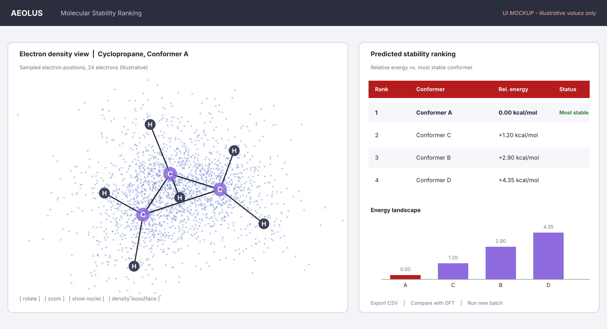

# AEOLUS

Electron density datasets from [FermiNet](https://github.com/google-deepmind/ferminet), with a 3D viewer.

The long-term goal is a molecular stability ranking tool: sample electron densities for several
conformers of a molecule, then rank them by predicted energy. This repository is at the first step,
a single hydrogen atom run end to end.



*Target UI. This is a mockup with illustrative values only; nothing in it is a computed result yet.*

## Status

| Piece | State |
|---|---|
| Hydrogen atom trained with FermiNet (CPU, 20,000 steps) | done |
| Energy vs the exact -0.5 Eh | offset 1.4e-6 +- 1.0e-6 Eh (steps 5,000 to 20,000) |
| Interactive 3D viewer of sampled positions | done, in `web/` |
| FermiNet observables (spin, dipole, density) | not computed yet |
| Molecules, conformer ranking, GNN training | planned |

The sampled electron positions also agree with the exact hydrogen 1s distribution: mean distance from
the nucleus 1.528 bohr against the exact 1.5.

## Try the viewer

The viewer loads a JSON file, so serve the folder instead of opening `index.html` directly:

```
cd web
python -m http.server
# open http://localhost:8000
```

With GitHub Pages enabled (Settings, Pages, Source: GitHub Actions), the workflow in
`.github/workflows/pages.yml` publishes `web/` on every push to `main`.

## Layout

```
aeolus/
  web/                      static viewer (HTML, CSS, JS, Plotly from a CDN)
    index.html
    css/style.css
    js/app.js
    data/hydrogen_v0.json   sampled positions, generated by aeolus.export_web
  src/aeolus/
    dataset.py              FermiNet run -> data/*.npz
    export_web.py           data/*.npz -> web/data/*.json
  configs/hydrogen.py       FermiNet config for the hydrogen atom
  data/hydrogen_v0.npz      first dataset file (about 0.4 MB)
  docs/
    kaggle_setup.md         environment notes for running FermiNet on Kaggle
    aeolus_ui_mockup.png    target UI mockup
  tests/
```

## Reproduce the dataset

1. Set up an environment and train hydrogen, following `docs/kaggle_setup.md`.
2. Build the dataset file. Loading checkpoints needs JAX:

   ```
   pip install -e ".[checkpoints]"
   python -m aeolus.dataset --run runs/h_run --out data/hydrogen_v0.npz
   ```

3. Regenerate the viewer data:

   ```
   python -m aeolus.export_web
   ```

Add `--inf runs/h_inf` in step 2 once you have an inference run with observables enabled. The density
reader has not yet been tested against a real run.

### What is in `hydrogen_v0.npz`

`energy`, `energy_step` and `pmove` (training trace after burn-in), `energy_offset_from_exact`,
`energy_stderr` (block-averaged), `walker_positions` (N x 3, bohr) with `walker_checkpoint_step`,
`mean_r`, and constants (`atomic_number`, `nuclear_position`, `units`, `exact_energy`). Observable keys
(`s2`, `dipole`, density matrices) appear when an inference run is supplied.

## Tests

```
pip install -e ".[dev]"
pytest
```

## Credits

The wavefunctions come from FermiNet. If you use this work, please cite the FermiNet paper:

> D. Pfau, J. S. Spencer, A. G. de G. Matthews, W. M. C. Foulkes. *Ab-initio solution of the many-electron
> Schroedinger equation with deep neural networks.* Phys. Rev. Research 2, 033429 (2020).

FermiNet is not vendored here; install it from its own repository.

## License

MIT, see `LICENSE`.
